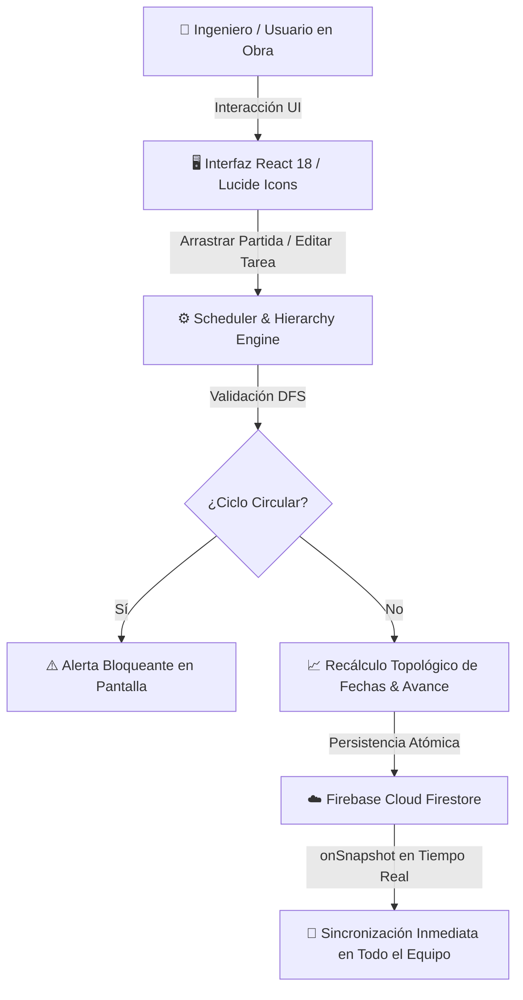

<div align="center">

# 📐 GANTTAGRAM
### *The Technical Blueprint Instrument*

**Plataforma de Alta Precisión para la Planificación y Control de Obras mediante Diagramas de Gantt**

[](https://ganttagram.web.app)
[](https://react.dev/)
[](https://vitejs.dev/)
[](https://tauri.app/)
[](https://firebase.google.com/)
[](https://vitest.dev/)

[🌐 Ver Aplicación en Vivo](https://ganttagram.web.app) • [📖 Documentación](#-documentación-y-guía-paso-a-paso) • [🏗️ Arquitectura](#-arquitectura-y-flujo-de-datos) • [🚀 Puesta en Marcha](#-instalación-y-desarrollo-local)

</div>

---

## 📌 ¿Qué es GANTTAGRAM?

**GANTTAGRAM** es una solución integral de gestión y programación de proyectos de ingeniería y construcción que combina la agilidad y fluidez de una aplicación web moderna con la exactitud y estética de un plano técnico digital (**Industrial-Tech Premium / Blueprint Light**).

Ha sido concebida específicamente para superar las limitaciones de las herramientas genéricas de productividad, adaptándose a la estructura de **partidas, metrados, rendimientos y dependencias críticas** que exige la ejecución técnica de obras en terreno.

Disponible como **Web SPA progresiva (PWA)** y como **aplicación de escritorio de alto rendimiento empaquetada con Tauri**.

---

## 🎯 ¿Para qué sirve?

* ⚡ **Cálculo Determinista de Fechas (Motor ASAP)**: Sincroniza automáticamente los cronogramas en cascada según las relaciones de precedencia entre partidas.
* 🛡️ **Protección Anti-Ciclos**: Algoritmo DFS que detecta y bloquea dependencias circulares antes de guardarlas, evitando bloqueos en el cronograma.
* 🌲 **Jerarquía de Partidas RNE**: Agrupación multinivel (Partida Madre ➔ Subpartidas ➔ Tareas operativas) con cálculo automático de fechas extremas y avance ponderado.
* 👷 **Control de Recursos y Cuadrillas**: Asignación transparente de personal técnico, maquinaria y materiales por tarea.
* 📊 **Dashboard Ejecutivo en Obra**: Monitorización de métricas críticas (días restantes, porcentaje de avance acumulado, salud presupuestal y cuadrillas activas).
* 📱 **Modo Campo de Alta Densidad**: Interfaz responsiva con ocultamiento dinámico de paneles en scroll para maximizar la lectura de líneas de tiempo en laptops y tablets de obra.

---

## 👥 ¿Para quién es?

| Rol | Caso de Uso Principal |
|---|---|
| **👷 Ingenieros Residentes de Obra** | Control diario de partidas, actualización de avances en campo y ajuste interactivo de duraciones en el Gantt. |
| **🔍 Supervisores e Inspectores** | Auditoría de la ruta crítica, verificación de cumplimiento de plazos contractuales y validación de hitos clave. |
| **🏢 Gerentes de Proyecto y Oficina Técnica** | Visualización macro en el Dashboard Ejecutivo, planificación de asignación de recursos y toma de decisiones estratégicas. |
| **🤝 Equipos Multidisciplinarios** | Trabajo colaborativo en tiempo real con roles diferenciados (*Propietario*, *Editor*, *Lector*). |

---

## ✨ Características Principales

```
├── 📅 Cronograma Gantt Interactivo (Escalas por Día, Semana y Mes)
├── 🔄 Motor Topológico de Dependencias con Programación ASAP Estricta
├── 🛡️ Detección en Tiempo Real de Dependencias Circulares (DFS)
├── 📊 Dashboard con Métricas de Salud del Proyecto y Días Restantes
├── 🎨 Estética "Technical Blueprint" (Slate 900 / Blueprint Blue / Safety Orange)
├── 🌓 Selector de Tema Claro / Oscuro con Alta Legibilidad Bajo el Sol
├── 👥 Gestión de Colaboradores e Invitaciones Atómicas en Tiempo Real
├── 💻 Empaquetado de Escritorio Nativo Multiplataforma con Tauri (Rust)
└── 📴 Soporte PWA y Persistencia Local
```

---

## 🔄 Arquitectura y Flujo de Datos



---

## 📖 Guía Paso a Paso: ¿Cómo Usar GANTTAGRAM?

### Paso 1: Acceso y Creación de Proyecto 🔑
1. Inicia sesión con tus credenciales o regístrate en la plataforma.
2. Desde el **Dashboard Principal**, pulsa en **"Nuevo Proyecto"**.
3. Ingresa el nombre de la obra, código de control y fecha de inicio estimada.

### Paso 2: Estructuración del Cronograma (WBS / EDT) 📝
1. Accede al espacio de trabajo del proyecto en `/projects/:id`.
2. Añade partidas maestras (ejemplo: *01 Obras Provisionales*, *02 Estructuras*).
3. Desglosa subpartidas y tareas específicas con sus duraciones estimadas en días laborables.

### Paso 3: Vinculación de Predecesores y Dependencias 🔗
1. Abre el modal técnico de la tarea o arrastra los conectores visuales en el gráfico Gantt.
2. Selecciona la tarea predecesora. El motor **ASAP** posicionará el inicio de la tarea inmediatamente después del cierre de su predecesora.
3. El sistema valida automáticamente la ausencia de bucles cerrados.

### Paso 4: Asignación de Recursos y Equipos 🚜
1. En la pestaña lateral de **Recursos**, registra cuadrillas, operadores o equipos especiales.
2. Asocia los recursos a cada partida para balancear la carga de trabajo en el cronograma.

### Paso 5: Monitoreo Ejecutivo y Seguimiento de Obra 📊
1. Revisa las métricas del encabezado superior: porcentaje global de avance, días de plazo restantes y tareas críticas.
2. Conforme se ejecutan los trabajos, actualiza el porcentaje de avance individual; los grupos padre recalcularán su ponderación automáticamente.

---

## 🛠️ Stack Tecnológico

| Capa | Herramienta | Versión | Rol |
|---|---|---|---|
| **Frontend** | React | `^18.3.1` | Librería principal de interfaz reactiva |
| **Bundler** | Vite | `^7.2.4` | Servidor ultrarrápido y compilador de producción |
| **Estilos** | Vanilla CSS + Design Tokens | Modern | Arquitectura de estilos *Industrial-Tech* sin sobrecarga |
| **Gantt Engine** | `gantt-task-react` | `^0.3.9` | Renderizado SVG optimizado del diagrama temporal |
| **Iconografía** | Lucide React | `^0.563.0` | Conjunto único y uniforme de iconos vectoriales |
| **Backend & Auth** | Firebase SDK | `^12.8.0` | Autenticación y Cloud Firestore en tiempo real |
| **Desktop App** | Tauri CLI & API | `^2.10.1` | Contenedor ejecutable nativo en Rust |
| **Testing** | Vitest + Testing Library | `^4.0.18` | Suite completa de pruebas unitarias y de integración |

Para consultar la directriz técnica de dependencias, revisa [STACK.md](./STACK.md).

---

## 🏛️ Estándar de Contexto del Repositorio

El proyecto sigue rigurosamente el **Estándar de Ingeniería de Contexto para Agentes de IA (v1.1.0)**:

* 📄 [PROJECT.md](./PROJECT.md) — Visión, usuarios objetivo, alcance y límites del producto.
* 📐 [ARCHITECTURE.md](./ARCHITECTURE.md) — Flujos del sistema, esquema Firestore y patrones adoptados.
* 🎨 [DESIGN.md](./DESIGN.md) — Sistema de diseño *Industrial-Tech Premium*, tokens y componentes UI.
* 📦 [STACK.md](./STACK.md) — Versiones fijas aprobadas y política anti-duplicación de librerías.
* 🚦 [RULES.md](./RULES.md) — Guardrails estrictos y restricciones operativas mandatorias.
* 🧪 [TESTING.md](./TESTING.md) — Comandos deterministas de comprobación y ciclo de 5 pasos.
* 🗺️ [ROADMAP.md](./ROADMAP.md) — Sprint activo, tareas atómicas e hitos completados.
* 📚 [docs/adr/](./docs/adr/) — Registro histórico de Decisiones de Arquitectura (ADRs).

---

## 🚀 Instalación y Desarrollo Local

### 1. Clonar el repositorio
```bash
git clone https://github.com/salempc-pe/ganttagram.git
cd GANTTAGRAM
```

### 2. Instalar dependencias
```bash
npm install
```

### 3. Configurar variables de entorno
Crea un archivo `.env.local` en la raíz del proyecto con tus credenciales de Firebase:
```env
VITE_FIREBASE_API_KEY="tu-api-key"
VITE_FIREBASE_AUTH_DOMAIN="tu-proyecto.firebaseapp.com"
VITE_FIREBASE_PROJECT_ID="tu-proyecto"
VITE_FIREBASE_STORAGE_BUCKET="tu-proyecto.firebasestorage.app"
VITE_FIREBASE_MESSAGING_SENDER_ID="tu-sender-id"
VITE_FIREBASE_APP_ID="tu-app-id"
```

### 4. Iniciar servidor de desarrollo
```bash
npm run dev
```
La aplicación estará disponible en `http://localhost:5173`.

### 5. Ejecutar la suite de pruebas
```bash
npm run test -- --run
```

### 6. Compilar para producción
```bash
npm run build
```

---

## ☁️ Despliegue en Firebase Hosting

Este proyecto se despliega oficialmente en **Firebase Hosting**:

```bash
# 1. Compilar los artefactos
npm run build

# 2. Desplegar a producción
firebase deploy --only hosting
```

> **Regla Operativa:** Cualquier despliegue a Firebase Hosting se sincroniza de forma inmediata y bidireccional con el repositorio en GitHub.

---

<div align="center">

Hecho con precisión técnica para la ingeniería de proyectos 🇵🇪  
**GANTTAGRAM © 2026**

</div>
